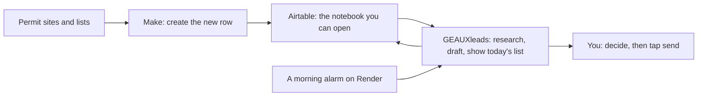

# GEAUXleads architecture review

Reviewed 11 November 2026 for Ryan. This is a read-only review. Nothing was changed in the app, Airtable, or Make, and no paid lookup was run.

Checked this morning against the live site (`https://geauxleads.onrender.com` and `https://geauxleads-1.onrender.com`) and against the code on `main` at the enrichment update (pull request 44).

---

## Fix these first

**1. The site has no lock on the door.**

There is no login. The address your phone uses is open to anyone on the internet, and the site publishes a full map of its buttons at `/docs`.

That map includes the button that sends email from your Gmail, the button that runs the paid research batch, and a download of every lead (names, phones, emails, notes). I did not press any of those. I only read status pages.

Until a lock is added, a stranger can:

- send a message that looks like it came from you, and the lead gets marked as contacted
- run the research batch and spend Perplexity and OpenAI credits
- read or export the whole lead list
- change statuses, drafts, and notes

The morning-email button is the one action that already asks for a secret. Almost everything else does not.

**2. The daily research job is not on a clock you can trust.**

The new batch (10 leads a day, no retry, stop after 3 failures in a row) is in the live code. The switch that runs it by itself (`ENRICHMENT_AUTO_ENABLED`) defaults to off, and I cannot see from outside whether you turned it on in Render.

Even with the switch on, the timer lives inside the website process. It waits 10 minutes after the site starts, then tries to run, then waits 24 hours. Any deploy, crash, or nap resets that wait. On Render's free plan the site goes to sleep after 15 quiet minutes, which is longer than that timer can survive, so the batch never comes due. A free site also cannot send mail on the port your one-press Gmail send uses (port 587), so that button fails on the free plan.

Nothing in this repo starts that timer on Render. The only schedule file is left over from the old Emergent host, and it only knows about the morning email. The "new info" review (up to 25 extra paid lookups, then the batch again) has no schedule at all. It runs only if something calls it.

**3. The "is the site up?" check would miss the crash you already had.**

A cleanup deleted one line. Every lead action then failed, while the health check still said the site was fine, because the health check never touches the leads path. That line is restored, and the leads list answered normally this morning. Nothing runs the test suite when code is merged, so the same kind of break can ship again.

---

## Verdict

The shape is right for a one-person business, and it is not good enough to leave as it is: the biggest weakness is an unlocked public site that can send mail as you and spend research money, with the daily job living on a timer that dies whenever the site restarts or sleeps.

You do not need a new platform. You need a lock, one morning alarm, and one cook in the kitchen for contact details.

---

## What is actually running

Verified live this morning:

| Check | Result |
| --- | --- |
| Site up, data source | Yes. Airtable, 269 leads, answered in about a second (so it was awake; that does not tell me the plan) |
| Lead list after the recent crash | Working |
| Paid research connected | Yes (Perplexity). Drafts use OpenAI. Twilio lookup is on |
| Slack alerts | Off |
| Live "row changed" updates | Off. The Airtable webhook is not registered, so the page catches up on the next load |
| New enrichment route from the latest update | Deployed |

The pieces:

- **The app** (this repo): a React website and a Python API, both on Render, updating themselves when `main` changes. You approve merges, and that approval is a production release.
- **Airtable**, the same base and Leads table the app is already pointed at. This is the notebook. The app keeps a 45-second memory copy so it does not re-download the table on every tap. The base and table ids live in the Render settings.
- **Make**: brings leads in, and still does some classifying and portfolio notes. It has also cleared contact fields the app had just filled. The checklist for that is `docs/MAKE_FIXES.md`.
- **Your Claude chat**: still used as a copy-paste way to enrich leads. The app can do that job now.
- **Optional Mongo**: a side cache for research answers and a few notes. If it is empty, the app still runs. I could not see whether it is connected.

Who writes the contact fields today:

| Who | What they should own | What they also touch |
| --- | --- | --- |
| Make | New rows from permits and lists | Classification, portfolio notes, and sometimes a wipe of a contact the app saved |
| The app | Public-record lookup, phone and email, homeowner mailing address, drafts, the send button you tap | Follow-up dates after a real send |
| Claude chat | Advice about what to build next | Lead rows, when you paste a "nudge" in |
| Airtable formulas | Scores and money displays | Leave these alone. The app already only reads them |

Drafts stay drafts unless you tap the one-press email button. That button is real: it sends from your Gmail and then logs the touch. It does not send on its own. It also does not re-check the "do not contact this person" rules that the approve button uses. Homeowner numbers get an on-screen reminder to check Do Not Call. That reminder does not look anything up and does not dial.

---

## The setup to aim for

Keep four things. Give each one a single job.

- **Make** only creates a new lead. It stops rewriting phone, email, owner, mailing address, confidence, and the date the contact was checked.
- **Airtable** stays the notebook. You can still fix a row by hand, and you can still delete a bad row.
- **The app** does the research, writes the draft, and shows you who to call. Public-record homeowner lookup stays. Nothing sends until you tap send. A failed paid call is still not retried.
- **The morning alarm** is a Render cron job that runs once, calls the locked research address, and exits. The timer hidden inside the website gets turned off so a restart cannot also fire a batch.
- **Claude** stays a planning chat. It stops being a way to fill lead rows.

That is the best simple architecture available right now. A database move, a new enrichment vendor, and a second hosting company would all make this heavier for no gain at 269 leads.

---

## What to change, in order

Effort: **S** is a small, contained change. **M** is a careful change worth reading before you approve it. **L** would be a project. Nothing below is an L.

### 1. Put a password on the site

**What.** A single password you type once on your phone. After that, reading leads, editing them, researching, drafting, and sending all require it. The plain "is it up?" check stays open so a monitor can hit it. The send button also starts obeying the same do-not-contact rules as approve.

**Why.** This closes the open door in the urgent list. Hiding the link does not help, because the site lists its own buttons.

**Effort.** M.

**Monthly cost.** $0.

**Risk.** You set the password in Render and type it in the app once. If the password is wrong, the app asks again. Research and send stop working for anyone who does not have it, which is the point.

**Who.** A code update for you to approve, then you add the password in the Render settings for the API. No Airtable or Make change.

### 2. Run the tests before a change goes live, and make the health check honest

**What.** GitHub runs the Python tests on every pull request, before you merge. The health check also loads the leads list, so a break like the deleted-line crash shows up as "down" instead of "fine."

**Why.** The tests already exist. Nothing runs them on merge. The only GitHub workflow runs when someone cuts a release, and it looks for a Node package in the wrong folder, so it does not protect this app. The health check currently says OK whenever Airtable answers, even if the lead actions are broken.

**Effort.** S.

**Monthly cost.** $0.

**Risk.** A bad test can hold up a good change until it is fixed. That is the trade you want.

**Who.** A code update for you to approve. In Render, turn on the email that tells you when a deploy fails, if it is not already on.

### 3. Give the daily research a real morning alarm

**What.** One Render cron job, once each morning, calls the locked research address. Cap stays at 10 leads. No retry. Stop after 3 failures. Leave the 25-lead "new info" scan off the clock until you decide you want that extra bill (see Money). Turn `ENRICHMENT_AUTO_ENABLED` off so the in-website timer is not a second trigger. In the Render dashboard, look at the API service's plan:

- If it already says Starter or higher, leave the plan alone. The site stays awake, and the one-press Gmail send is allowed to use port 587.
- If it says Free, move that one service to the $7 plan. Free sleeps after 15 quiet minutes, which kills the daily job and makes the site take about a minute to wake up. Free also blocks the mail port, so one-press send cannot work there.

**Why.** A timer inside the website forgets its place on every update and cannot run while the site is asleep. A cron job runs and exits. You already have the batch. It needs an alarm, not a rewrite.

**Effort.** S for the lock on that address (it can ship with item 1). The cron itself is a few clicks.

**Monthly cost.** About **$1** for the cron (Render's minimum for a cron job; the minutes themselves are pennies). **$7** more only if the API is still on the free plan. **$0** if you are already on a paid web service and only add the cron.

**Risk.** The first morning can research up to 10 leads, on the order of 30 cents, and may write a draft. It will not send anything. If both the timer and the cron are left on, the cap still stops the day at 10, but the logs get confusing, so turn the in-site switch off.

**Who.** A small code update so the research address requires the same secret as the morning email. You create the cron in Render and set the secret there. You flip the auto switch off in the API's environment settings.

### 4. Make creates rows. The app fills contacts. Claude stops editing leads

**What.** In the Make scenarios that run after a lead exists, stop them from clearing or overwriting `Contact name`, `Contact phone`, `Contact email`, `Owner`, `Owner Mailing Address`, `contact confidence`, and `Contact Verified Date`. Keep the scenario that creates a new lead from a permit. Retire the copy-paste "nudge Claude to enrich" habit. The in-app Find contact button and the morning batch replace it. Step-by-step clicks are already in `docs/MAKE_FIXES.md`. Leave the "no retry on a paid module" and "no auto-send" rules in place.

**Why.** Three writers on the same cells is why a contact can appear and then vanish. The app already knows how to look up a public-record owner and how to store a draft. Make is still the right tool for "a new permit showed up, add a row," because that work is a schedule plus a form, and you can see it.

**Effort.** M, and it is careful clicking, not a code project.

**Monthly cost.** $0. A slimmer Make setup may let you stay on a smaller Make plan. I could not see your current Make bill.

**Risk.** If the intake scenario is turned off, new permits stop arriving. Change the update steps that touch contact fields. Leave the "create a row" scenario running. If a research run says Airtable rejected `Research failed`, add that one option to Enrichment status, as `docs/MAKE_FIXES.md` describes.

**Who.** You, in Make. You, by not pasting leads into Claude for enrichment. No code required for this item. No new paid service.

### 5. Stay on Airtable

**What.** Keep the base. Do not move the leads into Postgres, Mongo, or another database.

**Why.** 269 leads is a small notebook, and you can open a row and fix it yourself. That matters more than a "real" database. The limits that actually apply:

- **Records.** Free allows 1,000 records in the whole base, every table added together. Leads are 269. The landlords list alone is another 195, plus agents, property managers, and whatever sits in Raw Signals. You have room, and you should glance at the base total so a big permit import does not hit the ceiling.
- **API calls.** Every plan, including the expensive ones, allows about 5 requests a second. Going faster caused a 30-second lockout that froze the site on 3 October 2026. The main reader was given a "only one download at a time" guard after that. A second reader (the leads actions) still downloads the whole table without that guard. That is a small code fix, not a reason to move.
- **Monthly call allowance.** Free is 1,000 calls per month for the whole workspace, and Make spends from the same pile. The app re-reads all 269 leads when its 45-second memory copy expires (about 3 calls per read, and the home screen can trigger two readers). A busy morning can use a few hundred calls. Team is 100,000 calls and 50,000 records, at **$20 per person per month** if billed yearly, or **$24** month-to-month. Business, about $45, buys headroom you will not use.

**Effort.** S for the second download-guard, as a code update. The plan check is a glance at your Airtable billing page.

**Monthly cost.** $0 if you are already on Team. **$20 a month** if you are on Free and the app or Make is already bumping the 1,000-call cap. Do not buy Business for this.

**Risk.** Low. Moving databases would throw away the screen you already know how to edit, and the formulas Make and the app both read.

**Who.** You check the Airtable plan. A code update can add the missing download guard. No schema change.

### 6. Clean duplicate rows by hand when you see them

**What.** The app already hides extras so you are not asked to contact the same person twice. This morning: 269 leads, 17 groups of duplicates, 21 extra rows hidden, 248 treated as the real ones. 77 leads have so little filled in (no usable phone, email, permit, or address) that the app cannot tell whether they match anything. It does not delete anything.

**Why.** Deleting the extra copy is allowed, and it keeps the notebook honest. An automatic deleter is a good way to lose the row you meant to keep.

**Effort.** S, on your time, whenever you want. A later code update could show the pairs on one screen. That screen is optional.

**Monthly cost.** $0.

**Risk.** Deleting the keeper and keeping the thin copy. The app's choice of keeper prefers the row with more filled in, then the older row. Look before you delete.

**Who.** You, in Airtable. No code required.

### 7. Correct the old map so the next helper does not follow it

**What.** Two docs are out of date. `CLAUDE.md` still says the site is on Railway in one section (the environment section correctly says Render). `docs/INTEGRATIONS.md` still says the app never sends a message. The live site is on Render, and the one-press email button does send when you tap it. The old Emergent schedule file does not run on Render.

**Why.** The last crash came from a cleanup that trusted a tidy-looking edit. Stale instructions cause the same class of mistake.

**Effort.** S.

**Monthly cost.** $0.

**Risk.** Low. Docs only.

**Who.** A docs update for you to approve, separate from any behavior change.

---

## Money, at the current caps

Prices checked 11 November 2026 against each vendor's public pages. Your real invoice wins if it disagrees. I am not asking you to add a new company.

| Thing | What a month looks like | Change I am suggesting |
| --- | --- | --- |
| Perplexity, medium preset, the 10-a-day cap | About **2 to 3 cents a lookup** on Perplexity's own published examples. 10 a day, every day, is roughly **$5 to $10**. A failed call is not billed a second time, because the app does not retry | Keep the cap. This is the bill you already chose |
| The 25-lead "new info" scan, if something runs it every day | Another **25 lookups**, roughly **$15 to $25** on top, and then it also starts the 10-lead batch | Leave it off the clock. Run it by hand when you want it |
| OpenAI drafts (`gpt-4o-mini`) | **Under $1** at 10 drafts a day. The model is marked deprecated and still works at $0.15 per million input tokens and $0.60 per million output tokens | Leave it. Switch only when drafts actually start failing |
| Twilio lookup | About **1.5 cents** each time the lookup page opens on a phone number. It does not text or call | Leave it |
| Render website | The static site is **$0**. The API is **$0** on Free or **$7** on the smallest always-on plan | Pay the $7 only if the API is still Free. See item 3 |
| Render morning cron | **$1** minimum | Add this. See item 3 |
| Airtable | **$0** on Free, which is too small a call allowance for daily use with Make. **$20** a month for Team, one person, yearly billing | Pay Team only if you are still on Free. See item 5 |
| Make | Free is 1,000 credits. Core is about **$16** a month (about **$12** if billed yearly) for 10,000 credits in the US. A scheduled scenario spends a credit every time it looks, even when it finds nothing | No new plan. Slimming the scenarios in item 4 can lower this |
| Claude chat | Whatever you already pay for the chat. It is not an API line on this app | Stop using it to write lead rows. Keep it for planning |
| A new database, a new enrichment vendor, or a paid error tracker | Would be a new bill | Do not add these |

A reasonable steady bill, if the API is moved to $7, the cron is $1, Airtable is Team at $20, and only the 10-a-day research runs, is on the order of **$35 to $45 plus your existing Make plan**. If you already pay for a paid Render service and Airtable Team, the only new line is the **$1** cron. Research stays inside the cap you set.

---

## The data, in plain numbers

From this morning's read of the live lead list. No row was changed.

- 269 leads. 2 show as ready to contact. 161 sit in "needs research." 8 are marked for a call, a text, or a visit today. 24 are new.
- 204 have no usable contact. 110 have no address. 64 have a contact phone. 45 have a contact email. 58 have an owner. 35 have an owner mailing address.
- `contact confidence` is empty on all 269. The new research code fills High / Medium / Low when a lookup succeeds. Empty means a successful lookup has not written that column yet. The next Find contact, or the first real morning batch, should fill it on the leads it actually checks. Older rows stay blank until they are checked again (the app waits 14 days before it rechecks a lead on its own).
- `First message` is filled on 3 leads. The draft body is filled on 41. Same idea, two columns. The app writes both when it drafts. Make often writes neither.
- 26 mapped columns are empty on every lead (a second phone column, a second email column, Instagram, website, and others). 57 columns are filled on fewer than a quarter of the leads. 31 columns exist in Airtable that the app does not read. The app reads 132.
- 1 phone number on file is unusable. No lead was dropped because the app failed to read it.
- 11 follow-ups are due. 36 passed leads still have no reason filled in, out of 62 passed.
- The "waiting on you" promotion queue is empty this morning.
- Other tables the app can see: 195 landlords, 10 real-estate agents, 7 property managers, 0 investors.
- The warming board shows 23 leads touched and 0 replies. That is a sales fact. It is not a reason to rebuild the software. The 10-a-day cap is the right speed for a solo shop that must not retry a paid call.

---

## What I could not see

- Your Render plan (Free or paid). The site was awake this morning. That only proves it had traffic recently.
- Whether `ENRICHMENT_AUTO_ENABLED` is on in Render.
- Whether you already created a cron in the Render dashboard. The repo does not contain one.
- Your Airtable plan and this month's API-call count.
- Your Make plan, and which scenarios are still active. The code can only show the webhooks the app is able to call.
- Whether the optional Mongo cache is connected.

---

## What I deliberately did not recommend

- Moving off Airtable.
- Adding a new paid enrichment company. Perplexity plus OpenAI, with the cap and no retry, is enough.
- Auto-sending, auto-texting, or auto-dialing. The one-press send stays a tap you make.
- Auto-deleting duplicate rows.
- Raising the daily cap.
- A monitoring subscription. Item 2 plus Render's own deploy email covers the failure you already hit. A free uptime ping against `/api/health` is optional after that health check also tests the leads list.
- Rewriting the app into smaller services. One website and one API is the right size.
